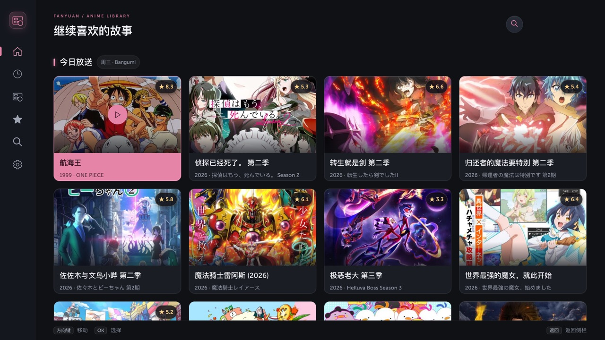
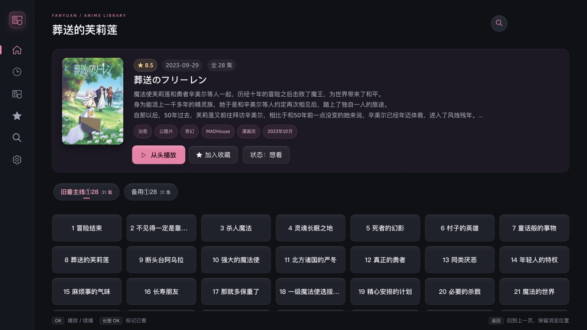
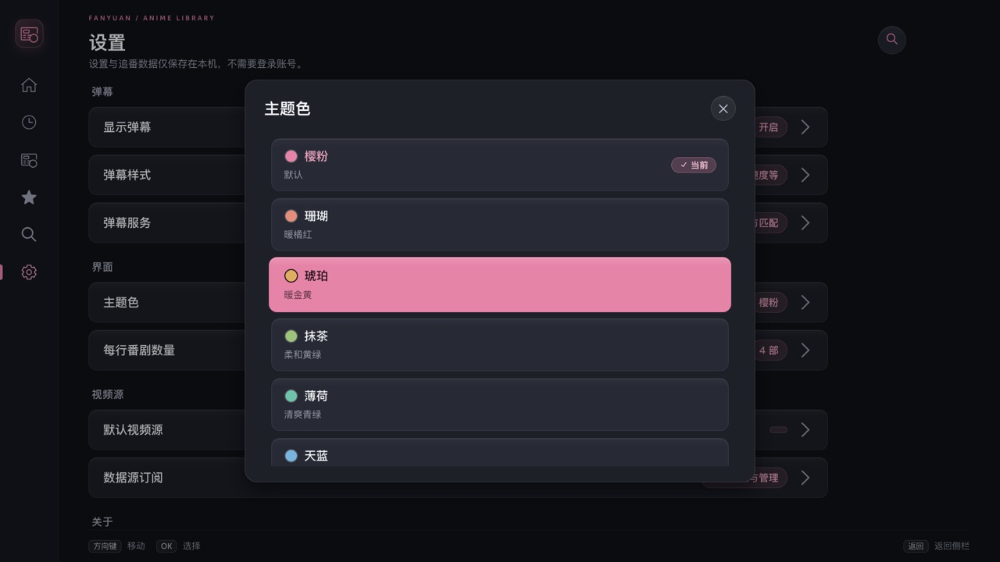

# 番源

LG webOS 电视上的追番与弹幕播放应用。在 LG C1（webOS 6）上开发和测试，不需要 root，也不需要另外部署服务器。



| 番剧详情与选集 | 主题色 |
|---|---|
|  |  |

## 功能

- **番剧资料**：每日放送时间表、本季热门、高分推荐、搜索、评分、简介和剧集列表，数据来自 [Bangumi](https://bgm.tv)。
- **追番记录**：收藏（想看 / 在看 / 看过）、观看历史、断点续播，长按剧集可标记已看。数据只保存在电视上，不需要登录。
- **视频源订阅**：兼容 [Animeko](https://github.com/open-ani/animeko) 的订阅格式。应用本身不带任何视频源，首次启动时下载默认订阅，可以在设置中添加、更换或停用。
- **播放**：选集、切换线路、倍速、自动连播下一集。
- **弹幕**：自动匹配番剧和剧集，可在播放器里手动选择，可调整开关、时间偏移、样式和密度。
- **为电视优化**：遥控器操作；针对 LG C1 这类性能较弱的电视优化了界面和弹幕渲染；提供 8 种主题色。

## 安装

先在电视上安装 [Homebrew Channel](https://github.com/webosbrew/webos-homebrew-channel)（开发者模式或 root 均可）。

### 方式一：添加番源的软件源（推荐）

番源没有收录在 Homebrew Channel 的官方软件源中，需要手动添加本项目的软件源。添加后可以直接安装，有新版本时也会提示更新。官方软件源的其他应用不受影响。

1. 打开 Homebrew Channel → 设置（Settings）。
2. 在附加软件源（Extra repositories）中添加：
   ```text
   https://fanyuantv.github.io/fanyuan-webos/apps.json
   ```
3. 回到应用列表，找到「番源」安装。

### 方式二：手动安装 IPK

从 [Releases](https://github.com/fanyuantv/fanyuan-webos/releases/latest) 下载 `.ipk` 文件，用 [webOS Dev Manager](https://github.com/webosbrew/dev-manager-desktop) 安装；或者在已开启开发者模式的电视上，用 LG 的命令行工具安装：

```sh
ares-install --device <设备名> io.github.fanyuantv.fanyuan_<版本>_all.ipk
```

手动安装的版本不会自动更新。之后改用软件源安装会直接覆盖，追番记录和设置都会保留。

## 使用说明

**遥控器**：方向键移动，OK 键选择，返回键后退；也支持动感应遥控器的指针和滚轮。播放时控制栏隐藏的状态下：

- 左右方向键：快退 / 快进 10 秒
- OK：暂停 / 继续
- 上下方向键：显示控制栏

**弹幕服务**：默认使用本项目部署在 Cloudflare Workers 上的 [danmu_api](https://github.com/huangxd-/danmu_api)，只提供弹弹play 来源的弹幕。**默认服务仅供测试使用，不保证稳定性**，可能会限流或停止服务。日常使用建议自己部署一个 danmu_api（可以获取更多平台的弹幕），然后在「设置 → 弹幕服务」中填写地址和 Token。

## 用到的外部服务

| 服务 | 用途 |
|---|---|
| [Bangumi](https://bgm.tv) | 番剧资料、放送时间表、剧集信息 |
| 视频源订阅（默认 `sub.creamycake.org`，可在设置中更换） | 视频源规则。播放来自哪些网站由订阅决定，与本项目无关 |
| danmu_api | 弹幕。默认使用本项目部署在 Cloudflare Workers 上的服务，也可以换成自己部署的服务 |
| `api.animeko.org` | 备用：订阅直接下载失败时，通过它代理下载；Bangumi 资料不完整时，查询分割放送的季度关系 |

## 从源码构建

需要 Node.js 18+ 和 LG 的命令行工具 [`@webos-tools/cli`](https://webostv.developer.lge.com/develop/tools/cli-installation)：

```sh
npm ci
npm run build
ares-package dist/app dist/service -o .
```

- 运行测试：`npm test`；界面测试需要 Node.js 22+ 和 [agent-browser](https://github.com/vercel-labs/agent-browser)，运行 `npm run test:ui`。
- 发布新版本：修改 `package.json` 的版本号，推送 `v<版本>` 标签。GitHub Actions 会自动测试、打包，把 IPK 发布到 Releases，并更新软件源。

## 致谢与许可证

- 本项目按 [MIT](LICENSE.txt) 许可证发布，为非官方项目，与 Animeko、BiliTV 和 LG 均无关。
- 界面基于 [Enact / Sandstone](https://github.com/enactjs/sandstone)（Apache-2.0）。
- 视频源订阅格式和弹幕匹配参考了 [Animeko](https://github.com/open-ani/animeko)。本仓库不包含任何视频源规则。
- 弹幕渲染和焦点管理的部分代码改写自 [BiliTV](https://github.com/asdf17128/bili-webos)（MIT，见 [`frontend/vendor/bilitv/LICENSE`](frontend/vendor/bilitv/LICENSE)）。
- 第三方依赖的许可证见 [`THIRD_PARTY_NOTICES/`](THIRD_PARTY_NOTICES/)。
